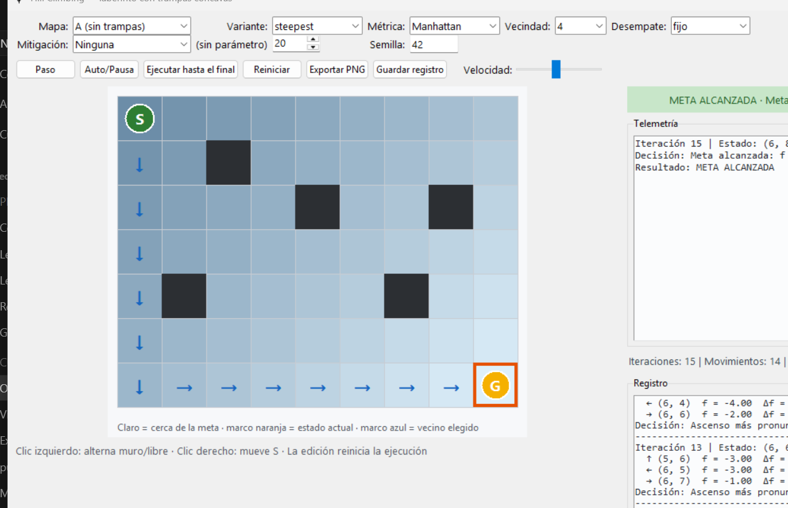
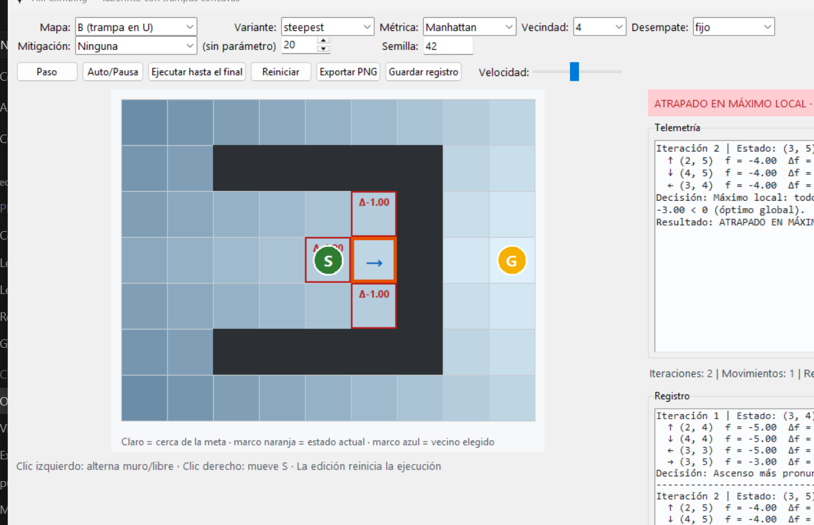
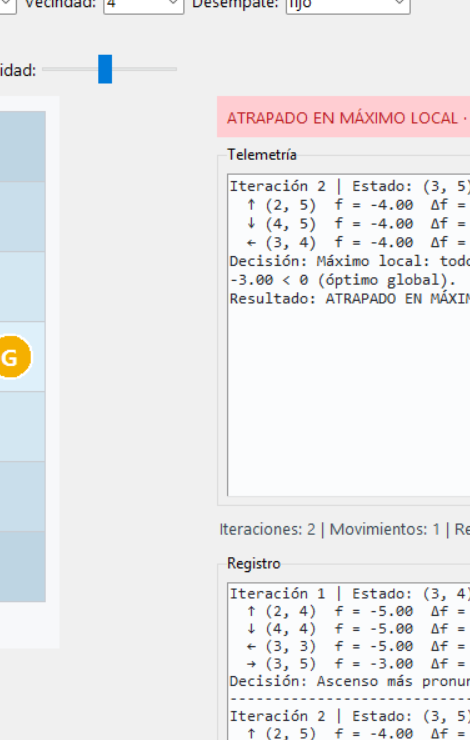
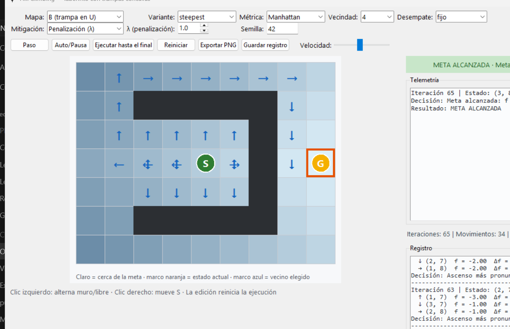
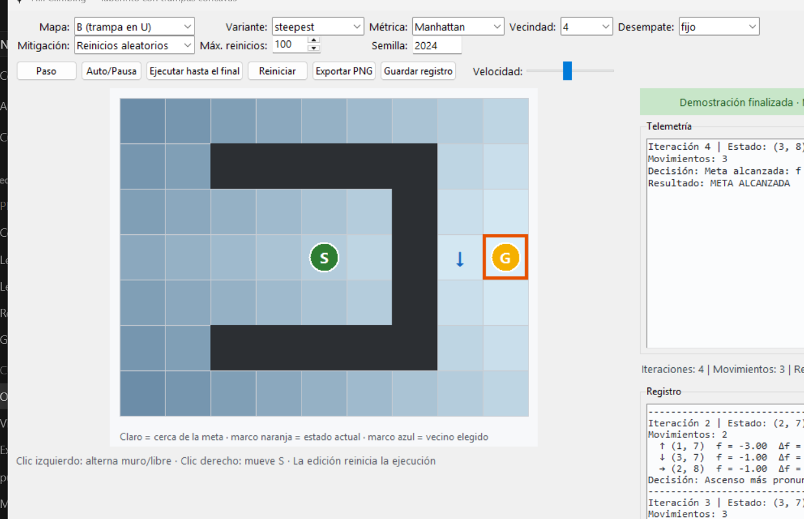
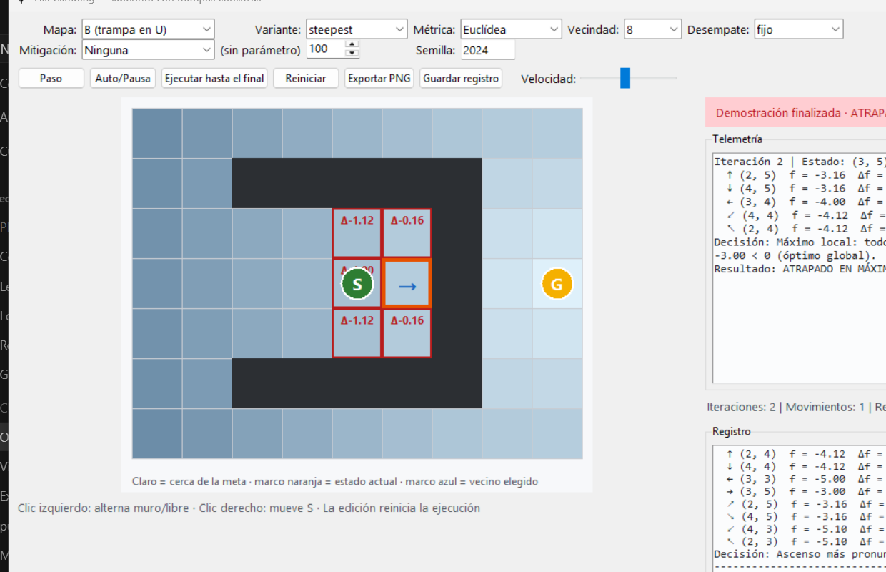
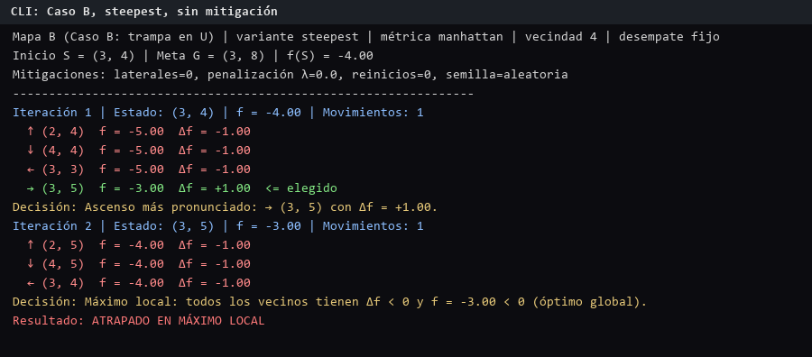
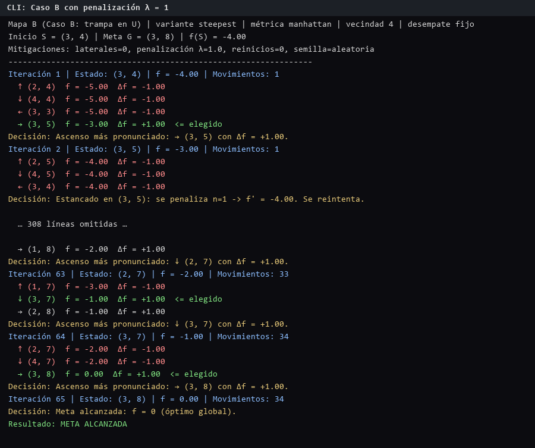

# Hill Climbing sobre un laberinto con trampas cóncavas

Implementación completa de **búsqueda local por Hill Climbing** sobre un
laberinto 2D con trampas cóncavas: modelado formal del problema, cuatro
variantes del algoritmo, tres mecanismos de mitigación del estancamiento,
interfaz gráfica paso a paso con telemetría por iteración, modo consola,
benchmark reproducible y verificación independiente de todas las cifras
publicadas.

---

## Resumen ejecutivo

**Problema.** Un buscador situado en la celda inicial `S` de una cuadrícula
7 × 9 debe alcanzar la meta `G` maximizando la función de aptitud
`f(s) = −d(s, g)`. El mapa B contiene un recinto en forma de U cuya abertura
mira en dirección contraria a la meta: el gradiente de `f` conduce al fondo
del recinto y la salida exige alejarse de `G`, un movimiento que Hill
Climbing nunca acepta.

**Algoritmo.** Búsqueda local *greedy*: en cada iteración evalúa los vecinos
del estado actual, se desplaza al que más mejore `f` (variante
*steepest-ascent*) y repite hasta que ningún vecino mejora. Mantiene un único
estado en memoria: **O(1)**. No planifica, no recuerda el camino recorrido y
no retrocede.

**Resultado.** En el mapa B el algoritmo termina en el máximo local `(3, 5)`
desde el **52,00 %** de los puntos de partida posibles. Las dos mitigaciones
efectivas resuelven el problema por completo, con un coste medido.

**Hallazgos.** La probabilidad de éxito no es una constante del mapa: depende
de la regla de desempate (entre 48,00 % y 56,00 %) y de la métrica de
distancia (48,00 % con Manhattan, 56,00 % con Euclídea). Además, contra la
intuición teórica, **no aparecen mesetas** con la vecindad de 8 direcciones:
se verifica una implicación celda por celda que lo demuestra.

| Magnitud | Valor medido |
|---|---|
| Mapa A: éxito desde cada celda libre | 58/58 = **100,00 %** |
| Mapa A: movimientos de `S` a `G` (steepest, Manhattan) | **14** (= distancia Manhattan) |
| Mapa B: `p = \|B(g)\|/\|F\|` | 24/50 = **48,00 %** |
| Mapa B: estancamiento | **52,00 %** (26 celdas, todas en el mismo sumidero) |
| Profundidad de barrera de `(3, 5)` | **7,00** |
| Penalización λ = 1: escape desde `S` | 65 iteraciones; éxito total **100,00 %** |
| Reinicios aleatorios | éxito **100,00 %**; **1,14** reinicios de media |
| A\* (contraste, misma heurística) | camino óptimo **16**, 48 nodos expandidos, frontera máxima 7 |

---

## El problema

Dos mapas de 7 × 9 (`S` = inicio, `G` = meta, `#` = muro):

```
Caso A — sin trampas cóncavas          Caso B — recinto en U
S . . . . . . . .                      . . . . . . . . .
. . # . . . . . .                      . . # # # # # . .
. . . . # . . # .                      . . . . . . # . .
. . . . . . . . .                      . . . . S . # . G
. # . . . . # . .                      . . . . . . # . .
. . . . . . . . .                      . . # # # # # . .
. . . . . . . . G                      . . . . . . . . .
```

**Modelado.** Sea `F` el conjunto de celdas libres y `g` la meta:

- **Estado**: `s = (r, c) ∈ F`.
- **Vecindario**: `N(s) = { (r±1, c), (r, c±1) ∩ F }`, explorado en orden fijo
  `↑ ↓ ← →`. Con vecindad de 8 direcciones se añaden las diagonales bajo la
  regla de **no cortar esquinas**: un diagonal solo es admisible si las dos
  celdas cardinales contiguas están libres.
- **Aptitud**: `f(s) = −d(s, g)`, con `d` de Manhattan
  (`|r−r_g| + |c−c_g|`) o Euclídea (`√((r−r_g)² + (c−c_g)²)`). El óptimo global
  es `f(g) = 0`.
- **Incremento**: `Δf(s, s′) = f(s′) − f(s)` para cada `s′ ∈ N(s)`.

En el mapa A no existe ningún estado sin vecino ascendente: el paisaje es
unimodal y cualquier ejecución llega a la meta. El mapa B introduce la trampa:
el interior del recinto tiene mejor `f` que su entorno inmediato, de modo que
el gradiente conduce al fondo del recinto y el algoritmo se detiene allí.

---

## El algoritmo

### Definición operativa

```
1. ¿s = g?                               → sí: TERMINAR (óptimo global)
2. Evaluar f(s′) para todo s′ ∈ N(s) y calcular Δf(s, s′)
3. ¿Existe s′ con Δf > 0?                → sí: s ← argmax Δf; ir a 1
4. ¿Existe s′ con Δf = 0?                → sí: MESETA (terminar)
5. Ningún vecino mejora                   → MÁXIMO LOCAL (terminar)
```

La variante *steepest-ascent* elige `argmax Δf` con desempate por orden de
exploración. Las otras tres variantes cambian solo la regla del paso 3:

| Variante | Regla de selección |
|---|---|
| `simple` | primer vecino con `Δf > 0` en el orden fijo |
| `steepest` | vecino con mayor `Δf`; empate → primero en el orden |
| `stochastic` | elección aleatoria con probabilidad ∝ `Δf` |
| `first_choice` | vecindario barajado; primer vecino con `Δf > 0` |

**Propiedades.** El algoritmo conserva un único estado (memoria O(1)) y una
secuencia de valores `f` estrictamente creciente: cada movimiento aceptado
tiene `Δf > 0`, luego ninguna celda se visita dos veces en una ejecución sin
mitigación.

### Por qué se atasca en el mapa B

En `(3, 5)`, con métrica Manhattan y `g = (3, 8)`:

| Vecino | `f(vecino)` | `Δf` |
|---|---|---|
| ↑ (2, 5) | −4,00 | **−1,00** |
| ↓ (4, 5) | −4,00 | **−1,00** |
| ← (3, 4) | −4,00 | **−1,00** |

`f((3, 5)) = −3,00`. La meta dista tres pasos en línea recta, pero `(3, 6)`
es muro: cualquier camino hacia `G` pasa por celdas con `f = −10`. Llegar a la
meta exige descender `f` y el algoritmo no acepta descensos. El estado es un
máximo local estricto: la terminación del paso 5 es el comportamiento correcto
del método, no un defecto de la implementación.

---

## Demostración visual

### 1. Caso A: convergencia al óptimo global



Steepest-ascent, orden fijo, métrica Manhattan. La ejecución alcanza `G` en 14
movimientos, todos con `Δf > 0`. El lienzo muestra el mapa de calor de `f`
(claro = cercano a la meta), el rastro de flechas del camino y el marco
naranja sobre la celda actual. El banner superior confirma la terminación por
meta alcanzada.

### 2. Caso B: atrapamiento en el máximo local (3, 5)



Desde `S = (3, 4)` la ejecución realiza un único movimiento hasta `(3, 5)` y
termina. Los tres vecinos libres aparecen con `f = −4,00` y `Δf = −1,00` en
rojo; el banner y la telemetría registran la condición de terminación exacta.

### 3. Telemetría de una iteración



Cada iteración expone: número de iteración, celda actual, `f(actual)`,
movimientos acumulados, la tabla completa de vecinos evaluados con
`f(vecino)` y `Δf` (verde si `Δf > 0`, rojo si `Δf < 0`, gris si `Δf = 0`),
la celda elegida, la razón de la decisión, el resultado final y los contadores
de estancamientos, penalizaciones y reinicios.

### 4. Mitigación por penalización



Con `f′(s) = f(s) − λ·n(s)` y `λ = 1`, cada estancamiento en `s` incrementa
`n(s)` y hunde `f′(s)` hasta que un vecino antes desventajoso pasa a ser el
mejor. La ejecución escapa del recinto y alcanza la meta.

### 5. Mitigación por reinicios aleatorios



El primer intento parte de `S` y fracasa; los siguientes inician en celdas
libres muestreadas uniformemente hasta alcanzar la meta. Con semilla `2024`
sufren dos reinicios.

### 6. Mapa de calor y vecindad de 8 direcciones



Métrica Euclídea y vecindad de 8. Los movimientos diagonales modifican la
distancia en cantidades no enteras, por lo que los `Δf` presentan decimales;
el sombreado codifica la distancia a la meta.

### 7. Modo consola





La CLI imprime la misma telemetría que la GUI con idéntico formato, e interpone
una pausa por iteración cuando se invoca con `--paso`.

---

## Resultados medidos

### Configuraciones del benchmark (mapa B, Manhattan, semilla 42)

| Configuración | Ejecuciones | Éxito | Estancamiento | Iter. medias (éxito) | Tiempo mediana |
|---|---|---|---|---|---|
| HC simple | 50 | 48,00 % | 52,00 % | 5,21 | 0,0395 ms |
| HC steepest | 50 | 48,00 % | 52,00 % | 5,21 | 0,0420 ms |
| HC estocástico | 1000 | 49,60 % | 50,40 % | 5,57 | 0,0460 ms |
| HC first-choice | 1000 | 50,90 % | 49,10 % | 5,71 | 0,0454 ms |
| Steepest + laterales L=20 | 50 | 48,00 % | 52,00 % | 5,21 | 0,0426 ms |
| Steepest + penalización λ=1 | 50 | **100,00 %** | 0,00 % | 38,04 | 0,2671 ms |
| Steepest + reinicios (máx. 100) | 1000 | **100,00 %** | 0,00 % | 11,34* | 0,0940 ms |

\* Iteraciones acumuladas de todos los intentos de la ejecución. Las
configuraciones deterministas se ejecutan de forma **exhaustiva desde cada
celda libre**, por lo que su tasa de éxito coincide exactamente con
`p = |B(g)|/|F|`. Las aleatorias usan 1000 ejecuciones con semilla fija. Los
tiempos son la mediana de 5 repeticiones con calentamiento previo (el
intervalo intercuartílico completo está en `results/metricas.csv`); los
tiempos dependen del equipo, documentado en `results/entorno.md`.

En el mapa A, las siete configuraciones alcanzan el 100,00 % desde las 58
celdas libres, con 7,97 iteraciones de media (7,89 en las variantes
aleatorias). La variante `simple` y la variante `steepest` obtienen la misma
tasa en el mapa B: cambiar la regla de selección altera el camino recorrido,
no la topología del paisaje, y ambas terminan en el mismo máximo local.

### Teoría frente a medición (reinicios aleatorios)

Sea `K` el número de intentos hasta el primer éxito, `R = K − 1` los reinicios
y `p` la probabilidad de éxito por intento con celda inicial uniforme. Con
`p = 0,48`:

| Magnitud | Teoría | Medido |
|---|---|---|
| Ejecuciones esperadas `E[K] = 1/p` | 2,08 | — |
| Reinicios esperados `E[R] = (1−p)/p` | 1,08 | **1,14** (IC 95 %: [1,04; 1,25]) |
| Reinicios si el 1.er intento parte de `S` (fallo seguro) | `1/p` = 2,08 | 2 (semilla 2024) |

El intervalo de confianza por bootstrap (5000 remuestreos) contiene el valor
teórico `E[R] = 1,08`; la cota `1/p = 2,08` solo aplica cuando el primer
intento parte de la trampa.

| Intentos permitidos `r` | Éxito teórico `1 − (1−p)^r` | Empírico (éxito en ≤ r intentos) |
|---|---|---|
| 1 | 48,00 % | 46,80 % |
| 2 | 72,96 % | 72,40 % |
| 3 | 85,94 % | 85,40 % |
| 4 | 92,69 % | 91,90 % |
| 5 | 96,20 % | 95,50 % |

### Contraste con A\*

A\*, con la misma heurística de Manhattan, resuelve el mapa B garantizando el
óptimo (16 movimientos) a cambio de expandir 48 nodos y mantener una frontera
máxima de 7 celdas. Hill Climbing mantiene exactamente un estado. La
diferencia entre ambos métodos es una decisión de diseño, no una jerarquía de
calidad: memoria O(1) y coste por iteración mínimo, a cambio de no garantizar
el óptimo.

---

## Análisis del paisaje

### Cuencas de atracción y profundidad de barrera

Ejecutando *steepest* desde cada celda libre se obtiene la cuenca de atracción
`B(s*)` de cada estado terminal:

- **Mapa A**: `p = |B(g)|/|F| = 58/58 = 100 %`. No existe ningún otro atractor.
- **Mapa B**: `p = 24/50 = 48 %`. Las 26 celdas restantes caen todas en el
  mismo sumidero `(3, 5)`.
- **Profundidad de barrera** `d(s°) = f(s°) − M`, donde `M` es el máximo, sobre
  todos los caminos que alcanzan un estado mejor, del mínimo de `f` a lo largo
  del camino: `d((3, 5)) = 7,00`. Todo camino de escape pasa por `(0, 1)` o
  `(6, 1)`, con `f = −10,00`.

### Las mesetas no existen: resultado negativo verificado

Con 4 direcciones, `Δf ≠ 0` para cualquier movimiento con Manhattan o
Euclídea. Con 8 direcciones, un movimiento diagonal puede dejar la distancia
Manhattan invariante, de modo que la teoría habitual anuncia mesetas.

**Medición**: 0 mesetas terminales en 16 combinaciones mapa × variante ×
vecindad, y 0 en los seis mapas aleatorios de escalabilidad. La causa es una
propiedad estructural, verificada celda por celda en 8 mapas y con ambas
métricas (0 excepciones):

> Bajo la regla de no cortar esquinas, si una celda tiene un vecino con
> `Δf = 0`, las dos celdas cardinales contiguas a ese diagonal están libres y
> tienen `Δf > 0`. Por tanto «tener movimiento lateral» implica «tener vecino
> ascendente», y un estado terminal sin ascendente pero con lateral —la
> meseta— es **inalcanzable**.

Consecuencia práctica: los movimientos laterales no se ejecutan nunca por sí
solos en estos mapas. Solo se activan cuando otra mitigación genera empates
(§ Mitigaciones).

### Dependencia del resultado respecto al desempate

Cuando varios vecinos empatan en `Δf`, la regla de selección entre ellos forma
parte del modelo y altera el resultado:

| Regla de desempate | `p` en el mapa B (Manhattan) |
|---|---|
| Orden fijo `↑ ↓ ← →`, primero de los empatados (la usada aquí) | **48,00 %** |
| Las 24 permutaciones del orden de exploración | 48,00 % – 56,00 % (σ = 3,27 pp) |
| Desempate aleatorio entre empatados (200 semillas) | 48,00 % – 56,00 % (media 50,30 %) |

Todas las cifras de este documento usan la primera regla, declarada de forma
explícita. Con métrica Euclídea, `p = 56,00 %` (28/50): la métrica cambia los
valores de `f` y, con ellos, las decisiones ante empates.

### Escalabilidad

Mapas aleatorios (semillas fijas, descartados los irresolubles por BFS) de
15 × 15 y 25 × 25 con densidad de muro creciente:

| Mapa | Densidad | `p` steepest (4 dir.) | Penalización λ=1 | Reinicios (máx. 100) |
|---|---|---|---|---|
| 15 × 15 | 10 % | 59,13 % | 100,00 % | 100,00 % |
| 15 × 15 | 20 % | 3,89 % | 98,89 % | 98,50 % |
| 15 × 15 | 30 % | 6,88 % | 100,00 % | 100,00 % |
| 25 × 25 | 10 % | 24,87 % | 99,82 % | 100,00 % |
| 25 × 25 | 20 % | 1,20 % | 100,00 % | 72,00 % |
| 25 × 25 | 30 % | 2,49 % | 94,34 % | 92,00 % |

Al crecer la densidad, `p` del steepest desciende hasta valores próximos al
1 %, mientras que la penalización se mantiene entre 94 % y 100 %. El caso
72,00 % (reinicios en 25 × 25 al 20 %) es consistente con la teoría: con
`p ≈ 1,2 %`, `E[K] ≈ 83` intentos y el presupuesto de 100 reinicios resulta
insuficiente para el 100 % de las ejecuciones.

---

## Mitigaciones del estancamiento

| Mecanismo | Formulación | Efecto medido |
|---|---|---|
| **Ninguna** | — | 48,00 % de éxito en el mapa B |
| **Movimientos laterales** | aceptar `s′` con `Δf = 0` hasta `L` veces; no se vuelve a la celda previa si existe alternativa | Sin efecto en solitario (no hay mesetas). Combinada con penalización se ejecuta 17 862 veces sobre las 50 celdas y multiplica el trabajo de 1 902 a 20 960 iteraciones, manteniendo el 100 % de éxito |
| **Penalización** | `f′(s) = f(s) − λ·n(s)`, con `n(s)` = estancamientos en `s` | Escape desde `S` en 65 iteraciones (34 movimientos, 30 penalizaciones); 100,00 % de éxito; 38,04 iteraciones de media por celda |
| **Reinicios aleatorios** | primer intento desde `S`; siguientes desde celda libre uniforme | 100,00 % de éxito; 1,14 reinicios de media (teoría: 1,08) |

El límite `L` de los laterales es necesario para garantizar terminación: sin
él, una meseta permitiría moverse indefinidamente sin mejorar ni empeorar.

---

## Controles de la interfaz

| Control | Función |
|---|---|
| Mapa | A, B o personalizado; editable con clic izquierdo (muro/libre) y clic derecho (mover `S`) |
| Variante | `simple` · `steepest` · `stochastic` · `first_choice` |
| Métrica | Manhattan o Euclídea |
| Vecindad | 4 direcciones, u 8 con diagonales sin cortar esquinas |
| Desempate | fijo por orden de exploración, o aleatorio entre empatados |
| Semilla | semilla del generador pseudoaleatorio; fija la trayectoria completa |
| Mitigación | ninguna · laterales con `L` · penalización con `λ` · reinicios con máximo |
| Paso / Auto / Final / Reiniciar | avance por iteración, automático con velocidad ajustable, ejecución completa y reinicio |
| Exportar PNG / Guardar registro | captura del estado actual e historial completo en `results/log.txt` |

Un mapa editado sin `S` o sin `G` no provoca excepciones: la interfaz muestra
un mensaje explicativo y deshabilita la ejecución hasta completarlo.

---

## Instalación y uso

Requisitos: **Python 3.10+**, `Pillow` y `pytest`.

```bash
# Windows (si el alias "python" no está disponible, usar "py")
py -m pip install -r requirements.txt

# Linux / macOS
python3 -m pip install -r requirements.txt

# Linux: Tk debe estar instalado por el sistema
#   Debian/Ubuntu:  sudo apt install python3-tk
#   Fedora:         sudo dnf install python3-tkinter
```

En Windows, `abrir_demo.bat` abre la interfaz con doble clic.

| Acción | Comando |
|---|---|
| Abrir la interfaz gráfica | `py run_gui.py` |
| Consola paso a paso | `py -m hillclimb.cli --mapa B --variante steepest --paso` |
| Ejecutar las pruebas | `py -m pytest -q` |
| Benchmark completo | `py -m hillclimb.benchmark` |
| Benchmark con Euclídea | `py -m hillclimb.benchmark --metrica euclidea` |
| Figuras del reporte | `py make_figures.py` |
| Verificación independiente | `py tools/verificacion_independiente.py --mapa A B` |
| Escalabilidad | `py -m hillclimb.escalabilidad` |
| Análisis de mesetas | `py -m hillclimb.vecindad8` |

Opciones de la CLI: `--metrica`, `--vecindad`, `--desempate`, `--laterales`,
`--penalizacion`, `--reinicios`, `--semilla`, `--max-iter`, `--auto`.

---

## Arquitectura

```
hill-climbing-lab/
├── run_gui.py                  # lanza la interfaz gráfica
├── abrir_demo.bat              # acceso directo para Windows
├── make_figures.py             # genera las figuras del reporte
├── hillclimb/
│   ├── maze.py                 # laberinto, vecindario 4/8 direcciones, f(s)
│   ├── algorithms.py           # variantes, mitigaciones y modo sin telemetría
│   ├── analysis.py             # cuencas, barrera, desempate, bootstrap
│   ├── astar.py                # A* como contraste de memoria
│   ├── benchmark.py            # métricas, tiempos y teoría de reinicios
│   ├── cli.py                  # modo consola paso a paso
│   ├── gui.py                  # interfaz Tkinter
│   ├── figures.py              # exportación PNG con Pillow
│   ├── vecindad8.py            # análisis de mesetas con 8 direcciones
│   ├── propiedad_mesetas.py    # verificación de la implicación de mesetas
│   └── escalabilidad.py        # mapas aleatorios 15×15 y 25×25
├── tools/verificacion_independiente.py   # segunda implementación, sin reusar el paquete
├── tests/test_core.py          # valores de referencia y mitigaciones
├── tests/test_auditoria.py     # robustez, reproducibilidad y GUI
├── docs/modelado.md            # modelado formal (S, N(s), f(s), Δf, p, B(s*))
├── docs/imagenes/              # capturas de la demostración
└── results/                    # métricas, tablas, figuras y entorno de medición
```

**Decisiones de diseño.** (1) Cada ejecución es un generador que produce un
objeto de telemetría por iteración; la GUI y la CLI lo consumen con `next()`,
por lo que el modo paso a paso no duplica la lógica de búsqueda, que reside
exclusivamente en `algorithms.py`. (2) El modo sin telemetría
(`hill_climbing_ligero`) resuelve el mismo problema sin construir esos objetos
y permite medir su coste: entre 0,58× y 1,50× por ejecución según la
configuración (`results/tiempo_telemetria.md`). (3) Los mapas y el orden de
exploración son tuplas inmutables; no existen variables globales mutables.

---

## Reproducibilidad y verificación

- **Determinismo.** Dos ejecuciones del benchmark producen el mismo
  `metricas.csv` salvo en las columnas de tiempo. Las semillas de todas las
  ejecuciones se derivan de una única semilla maestra (42).
- **Verificación independiente.** `tools/verificacion_independiente.py`
  reimplementa steepest-ascent, las cuencas de atracción y A\* sin importar
  `hillclimb.algorithms`, y contrasta las cifras publicadas: `p`, número de
  celdas libres, sumideros y longitud del camino óptimo coinciden.
- **Estadísticos robustos.** Los tiempos se reportan como mediana e IQR de 5
  repeticiones con calentamiento, no como medias, que son sensibles a valores
  atípicos del sistema.
- **Intervalos de confianza.** La comparación con la teoría de reinicios usa
  bootstrap (5000 remuestreos) sobre las 1000 ejecuciones.
- **Entorno documentado.** `results/entorno.md` registra versión de Python,
  sistema operativo y procesador; los tiempos no son comparables entre
  equipos sin reejecutar el benchmark.
- **Calidad estática.** 45 pruebas con `pytest`; `pyflakes` y `mypy` sin
  hallazgos; tipado y documentación en español en todos los módulos.

---

## Guion de presentación (4 personas, ~15 min)

Estructura en tres actos: el problema, la herramienta que funciona, y la
herramienta que falla. Exponer el atasco antes del contexto lo presenta como
un defecto; exponerlo después lo presenta como una propiedad.

### Persona 1 — El problema y el modelo (3 min)

Presentar los dos mapas y el modelado en tres componentes: estado, vecindario
con orden fijo y aptitud `f(s) = −d(s, g)`. Enfatizar la traducción: maximizar
`f` es minimizar la distancia a la meta, y el óptimo global vale `f(g) = 0`.
Cerrar anticipando la dificultad: en el mapa B, el camino hacia la meta pasa
por celdas peores que la actual.

> *Transición:* «Ese paisaje se recorre con un algoritmo muy simple y muy
> miope: Hill Climbing.»

### Persona 2 — El algoritmo y el Caso A (4 min)

Definición operativa en cuatro pasos y las cuatro variantes de selección.
Señalar las propiedades estructurales: memoria O(1), secuencia de `f`
estrictamente creciente, ausencia de revisitas.

Demostración en vivo: mapa A, steepest, sin mitigación. Avanzar con **Paso**
hasta mostrar varios `Δf` positivos y completar con **Ejecutar hasta el
final**. Resultado: meta en 14 movimientos, exactamente la distancia
Manhattan, y 58/58 celdas de éxito en el mapa completo.

> *Transición:* «El mapa A es el caso sin riesgo. Cambiemos a un mapa con una
> trampa.»

### Persona 3 — El atrapamiento (4 min)

Demostración en vivo: mapa B, **Reiniciar**, avanzar dos iteraciones con
**Paso**. La ejecución se mueve a `(3, 5)` y termina. Leer la telemetría en
voz alta: tres vecinos con `f = −4,00` y `Δf = −1,00`, terminación por máximo
local. Explicar la paradoja: la meta está a tres pasos, pero llegar exige
bajar `f`.

Presentar después las magnitudes del paisaje: `p = 24/50 = 48 %`,
estancamiento del 52 % concentrado en un único sumidero, barrera de
profundidad 7,00. Mencionar las mesetas: se midieron y no aparecen, con la
razón verificada (toda celda con lateral tiene ascendente), y la dependencia
del desempate (48 %–56 %).

> *Transición:* «Un método que falla en la mitad de los inicios solo es
> utilizable con mecanismos de escape. Hay tres.»

### Persona 4 — Mitigaciones, métricas y cierre (4 min)

Tres demostraciones seguidas, cada una con su lectura:

1. **Penalización** (λ = 1): la ejecución escapa; 65 iteraciones desde `S`,
   100 % de éxito global, a cambio de ~6× más tiempo por ejecución.
2. **Reinicios** (semilla 2024): primer intento fallido, éxito en el segundo
   o tercero; media medida 1,14 frente a 1,08 teóricos, con el valor teórico
   dentro del intervalo de confianza.
3. **Laterales** (L = 20): sin efecto por sí solos, porque no hay mesetas;
   activan 17 862 veces junto a la penalización y multiplican el trabajo por
   11. El límite `L` garantiza la terminación.

Cerrar con la tabla de `results/tabla_metricas.md` y tres ideas: la búsqueda
local es un intercambio de garantías por recursos, no una versión degradada
de A\*; el atrapamiento es predecible y cuantificable (`p`, barrera); y una
cifra sin su intervalo de confianza, su regla de desempate y su entorno de
medición no es un resultado.

### Preguntas previsibles

| Pregunta | Respuesta |
|---|---|
| ¿Por qué no usar A\*? | A\* garantiza el óptimo pagando memoria proporcional al espacio explorado; Hill Climbing paga memoria constante sin garantía. La elección depende del presupuesto de memoria y de la criticidad del óptimo. |
| ¿Qué ocurre si la meta es inalcanzable? | Los reinicios se agotan y la ejecución termina con el estado `max_reinicios`, sin bloquearse. Hay una prueba que lo verifica. |
| ¿Son fiables las cifras? | El benchmark es determinista salvo en tiempos, existe una segunda implementación independiente que las recalcula, y la comparación con la teoría incluye intervalos de confianza. |
| ¿Qué papel juega λ? | Intensidad de la penalización: con λ = 1 basta para escapar; valores menores ralentizan el escape y mayores distorsionan antes el paisaje. |
| ¿Por qué dos métricas? | Para medir la sensibilidad del paisaje a la definición de `f`: Manhattan produce valores enteros, Euclídea decimales, y `p` pasa de 48 % a 56 %. |

### Riesgos durante la exposición

1. Exponer el atasco antes del caso de éxito: sin el contraste, la parada
   parece un defecto de implementación.
2. Dejar la métrica en Euclídea para la demostración principal: los `Δf`
   decimales dificultan la lectura en directo; Manhattan produce `−1,00`.
3. Citar cifras sin declarar la regla de desempate: quien las reproduzca con
   otro orden obtendrá 56 % en lugar de 48 %.

---

## Conclusiones

1. **La búsqueda local es un intercambio, no una versión degradada de A\*.**
   Memoria O(1) y costes de décimas de milisegundo, a cambio de ninguna
   garantía de óptimo. La elección entre ambas es una decisión de ingeniería
   que este trabajo cuantifica.
2. **El atrapamiento es una propiedad medible del paisaje.** La cuenca de
   atracción `p = |B(g)|/|F|` y la profundidad de barrera `d(s°)` predicen
   cuándo y dónde falla el método: 52 % de inicios, un único sumidero, barrera
   de 7,00.
3. **Cada mitigación tiene un coste, y ese coste se mide.** La penalización
   resuelve el 100 % con ~6× más tiempo; los reinicios resuelven el 100 % con
   1,14 reinicios de media; los laterales no aportan nada sin mesetas y, junto
   a la penalización, multiplican el trabajo por 11.
4. **Un resultado es una cifra más sus condiciones.** Regla de desempate,
   métrica, vecindad, intervalo de confianza y entorno de medición forman parte
   del resultado. Omitirlas hace irreproducible la cifra.
5. **La verificación independiente es parte del método.** Recalcular las
   magnitudes con una implementación separada, sin reusar el código medido, es
   la única forma de detectar errores que la propia herramienta no puede ver
   en sí misma.

---

*Trabajo académico de la asignatura Fundamentos de Inteligencia Artificial /
Algoritmos de Optimización. Todas las cifras provienen de `results/`,
regenerable con `python -m hillclimb.benchmark`; el modelado formal completo
está en `docs/modelado.md`.*
